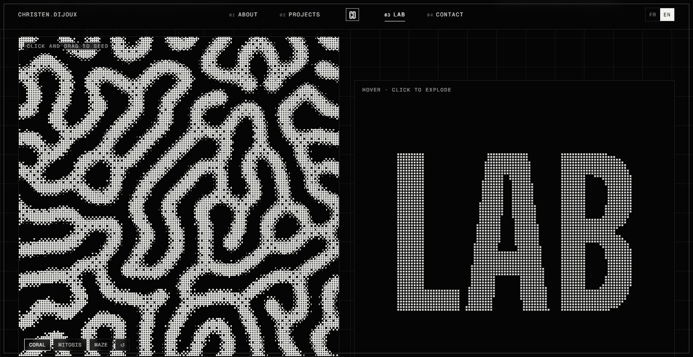

<a href="https://christendijoux.com"></a>

# Christen Dijoux — Portfolio

Personal portfolio of **Christen Dijoux**, full-stack & AI developer based in Saguenay, Québec.
Monochrome editorial design, dithered WebGL, kinetic typography, a lab that takes the site apart — and a few hidden surprises.

**Live → [christendijoux.com](https://christendijoux.com)** · **Lab → [christendijoux.com/lab](https://christendijoux.com/lab)** · FR / EN

---

## Concept

Two colours, one algorithm. Every visual on the site — the hero sphere, the globe, the project images — goes through the same idea: **8×8 ordered dithering** on an ink / paper palette (`#050505` / `#F2F2EE`). No stock imagery, no video: the identity is generated in the browser.

Typography carries the rest: **Big Shoulders Display** (variable, condensed) for headlines, **Geist** for text and **Geist Mono** for labels, numbering and metadata.

## Pages

| Page | What's there |
| --- | --- |
| **Home** | WebGL hero, manifesto band, about (pillars, stack, experience, journey globe), pinned project gallery, Lab teaser, contact form |
| **Projects** | Full index of case studies and GitHub repositories, filterable by language |
| **Case studies** | Context, role, stack, challenges, results and screenshot galleries, with a shared-image transition from the gallery |
| **Lab** | Every component of the site dissected live + free experiments (see below) |
| **Resume** | Screen version and a dedicated one-page print layout; FR / EN PDFs |
| **Legal** | Privacy policy and legal notice (Loi 25 / GDPR) |

## Highlights

- **Dithered WebGL hero** — raymarched noise sphere with Bayer 8×8 dithering, in plain WebGL (no 3D library). The shader compiles while the browser is idle (`KHR_parallel_shader_compile`), so it never blocks the first paint; on touch screens one dither dot = one computed pixel (≈ 25× less GPU work).
- **Kinetic type** — headline weight follows the cursor through the variable font axis; letter-by-letter reveals; paragraphs that light up word by word on scroll.
- **Journey globe** — canvas globe built from Natural Earth data: a great-circle arc from Réunion Island to Saguenay (14,420 km) drawn on scroll.
- **Pinned horizontal project gallery** (GSAP ScrollTrigger + Lenis) leading into full case-study pages.
- **Numbered editorial navigation** — symmetric menu around the monogram, active section tracked while scrolling, full-screen menu on mobile.
- **Easter eggs** — negative mode (Konami code, or 5 taps on the logo) with a View Transitions reveal, and a star hunt that unlocks a mini-game with an online leaderboard.
- **Local assistant** — rule-based chatbot (intent detection, weighted keywords, bilingual knowledge base generated from the site's own data). No external API, nothing sent to a third party.

## Lab

<a href="https://christendijoux.com/lab"></a>

`/lab` is a catalogue of the site's own components. Each entry shows a **live demo** and answers four questions: what it does, why it exists, how it works, and an honest verdict (relevance and performance cost). Retired components are listed too.

The second half is free experimentation:

- **Gray-Scott** — reaction-diffusion simulated on the GPU (WebGL2, float textures, ping-pong framebuffers), dithered in two colours; click to seed.
- **Type as matter** — a word sampled into particles held by springs; the cursor blows them away. Type your own word.
- **Flow field** — thousands of particles following a time-varying direction field, with a cursor vortex.
- **ASCII globe** — an archived hero prototype rendered in characters.

Demos mount only near the viewport and unmount when they leave it, so the page never keeps more than a few WebGL contexts alive. The home page only links to the Lab; its code is fetched on hover.

| Journey | Projects |
| --- | --- |
|  |  |

## Performance

- Route-level code splitting: secondary pages, the assistant and the mini-game are lazy-loaded.
- Vendor chunks split by library; Brotli and gzip files precompressed at build time.
- Hashed assets cached for one year (`immutable`); HTML and service worker always revalidated.
- HTML cached at the edge by Cloudflare.
- Every animation loop pauses off-screen; WebGL renders at reduced resolution and 30 fps on mobile.
- PWA service worker with automatic updates.

## Accessibility

- `prefers-reduced-motion` honoured everywhere: no smooth scroll, static WebGL frame, instant reveals.
- Skip link, keyboard-reachable controls, visible focus, focus restored when panels close.
- Animated text keeps a screen-reader copy (`sr-only`); decorative canvases are `aria-hidden`.
- Custom cursor and proximity effects disabled on touch screens.
- Contrast kept at WCAG levels even during scroll-driven fades.

## Security & privacy

- HTTPS only with HSTS, a Content-Security-Policy and hardened response headers (`public/.htaccess`).
- Analytics (GA4) and error tracking (Sentry) load **only after explicit consent** — Loi 25 / GDPR.
- No secrets in the repository; environment files are git-ignored.
- **Leaderboard API** (PHP, no database): HMAC-signed single-use game tokens, minimum real play time, score cap, strict nickname validation, per-IP rate limiting with the real client IP read only from verified Cloudflare ranges, file locking, data and signing key stored outside the web root.
- Responsible disclosure: see [SECURITY.md](SECURITY.md) and [`/.well-known/security.txt`](https://christendijoux.com/.well-known/security.txt).

## SEO & discoverability

Per-page titles, descriptions and canonical URLs, JSON-LD structured data, `hreflang` alternates, a generated sitemap, and `llms.txt` / `ai.txt` for AI crawlers.

## Quality

- **Vitest + Testing Library** — 60 tests: components, chatbot logic, star-hunt state, reduced-motion hook, FR/EN translation parity, and Lab index consistency.
- Strict TypeScript and ESLint.

## Stack

| Layer | Tools |
| --- | --- |
| UI | React 18 · TypeScript · Tailwind CSS 3 |
| Motion & graphics | GSAP + ScrollTrigger · Lenis · Framer Motion · WebGL / WebGL2 · GLSL · Canvas 2D |
| Content | i18next (FR / EN) · React Helmet |
| Build & quality | Vite 5 · Vitest · Testing Library · ESLint |
| Backend & hosting | PHP (leaderboard) · Apache · Cloudflare |
| Services | EmailJS · GA4 · Sentry (consent-gated) |

## Repository structure

```
src/
├── components/        sections, UI primitives, WebGL hero, Lab demos and experiments, assistant, mini-game
├── pages/             home, projects, case study, lab, resume, legal pages
├── data/              projects, skills, Lab content
├── i18n/locales/      French and English copy
├── hooks/  lib/       motion, scroll, consent and analytics helpers
└── tests/             Vitest suite
public/
├── api/               leaderboard API
└── .well-known/       security.txt and AI discovery files
scripts/               artwork, globe land mask, sitemap and resume PDF generators
docs/                  screenshots and assistant notes
```

## About this repository

The source is published as a showcase of the work behind the site — it is not a template and is not open source. See [LICENSE](LICENSE).

## Credits

Design & code by Christen Dijoux. Fonts: Big Shoulders Display, Geist, Geist Mono. Map data: Natural Earth.

© Christen Dijoux — all rights reserved.
