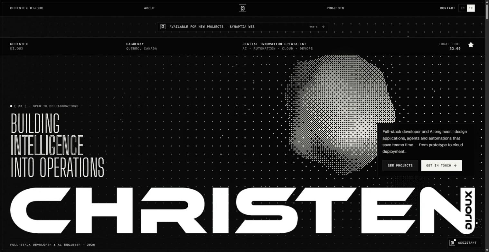
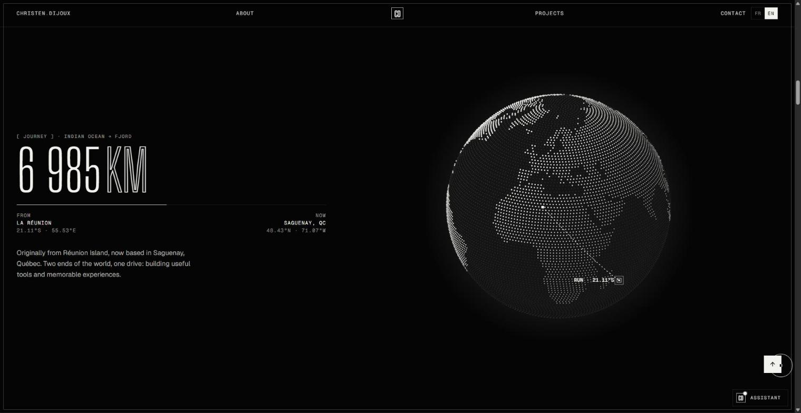
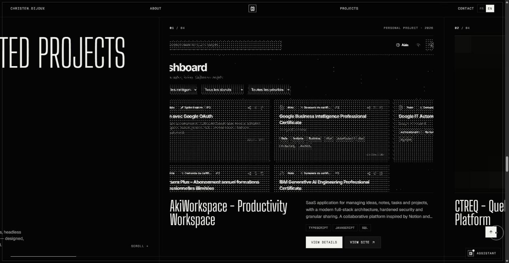

<a href="https://christendijoux.com"></a>

# Christen Dijoux — Portfolio

Personal portfolio of **Christen Dijoux**, full-stack & AI developer based in Saguenay, Québec.
Monochrome editorial design, dithered WebGL, kinetic typography and a few hidden surprises.

**Live → [christendijoux.com](https://christendijoux.com)** · FR / EN

## Highlights

- **Dithered WebGL hero** — raymarched noise sphere with Bayer 8×8 dithering — plain WebGL (no 3D library), non-blocking shader compile, framed above the title on mobile.
- **Kinetic type** — Big Shoulders Display variable font whose weight follows the cursor; split-text reveals.
- **Journey globe** — canvas globe built from Natural Earth data: a great-circle arc from Réunion Island to Saguenay (14,420 km) drawn on scroll.
- **Pinned horizontal project gallery** (GSAP ScrollTrigger + Lenis) and full case-study pages.
- **Star hunt mini-game** — find 3 hidden stars, then play a 20 s game with a PHP leaderboard (HMAC tokens, rate limiting, no database).
- **Local assistant** — rule-based chatbot answering about projects, skills and contact (no external API).
- **Resume** — screen version + dedicated one-page print layout; FR/EN PDFs generated with headless Chrome.
- **Privacy & a11y** — analytics and error tracking load only after opt-in consent (Loi 25 / GDPR), `prefers-reduced-motion` support, keyboard and screen-reader friendly.

| Journey | Projects |
| --- | --- |
|  |  |

## Stack

React 18 · TypeScript · Vite 5 · Tailwind CSS 3 · GSAP + ScrollTrigger · Lenis · WebGL · Framer Motion · i18next · Vitest · PHP (leaderboard API) · Apache / cPanel

## Getting started

```bash
npm install
npm run dev
```

| Script | What it does |
| --- | --- |
| `npm run dev` | Dev server |
| `npm run build` | Type-check + production build (`dist/`) |
| `npm test` | Vitest test suite |
| `npm run cv:pdf` | Regenerate FR/EN resume PDFs from `/cv` (dev server must be running) |
| `node scripts/generate-art.mjs` | Regenerate halftone artwork |
| `node scripts/generate-landmask.mjs` | Regenerate the globe land mask |

Optional environment variables are listed in `.env.example`.

## Deployment

Static build served by Apache (`public/.htaccess` handles SPA routing, caching and security headers).
Upload the contents of `dist/` to the web root. The leaderboard stores its data and secret key **outside** the web root.

## Credits

Design & code by Christen Dijoux. Fonts: Big Shoulders Display, Geist, Geist Mono. Map data: Natural Earth.

© Christen Dijoux — all rights reserved.
